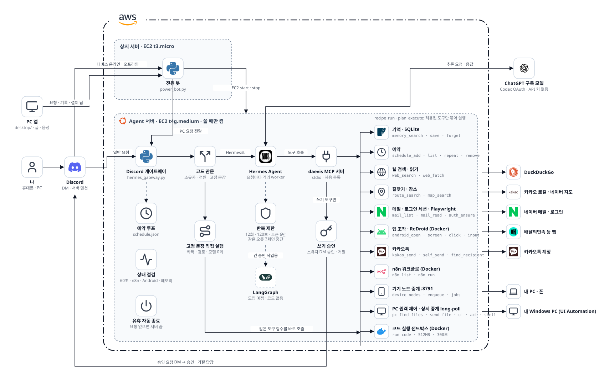
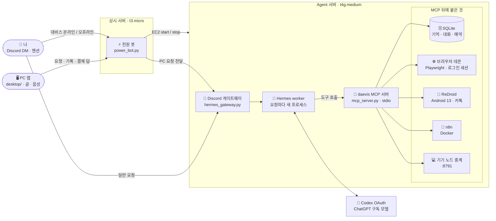
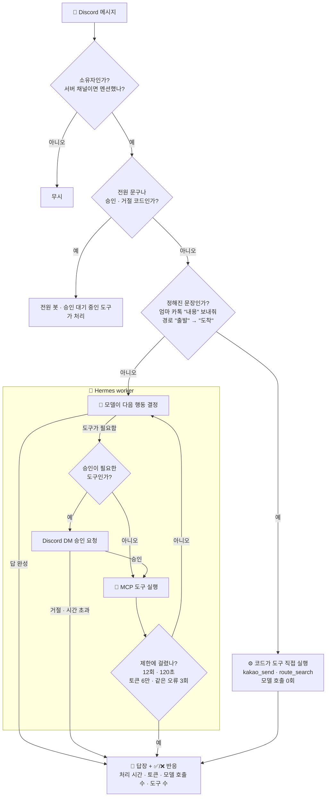
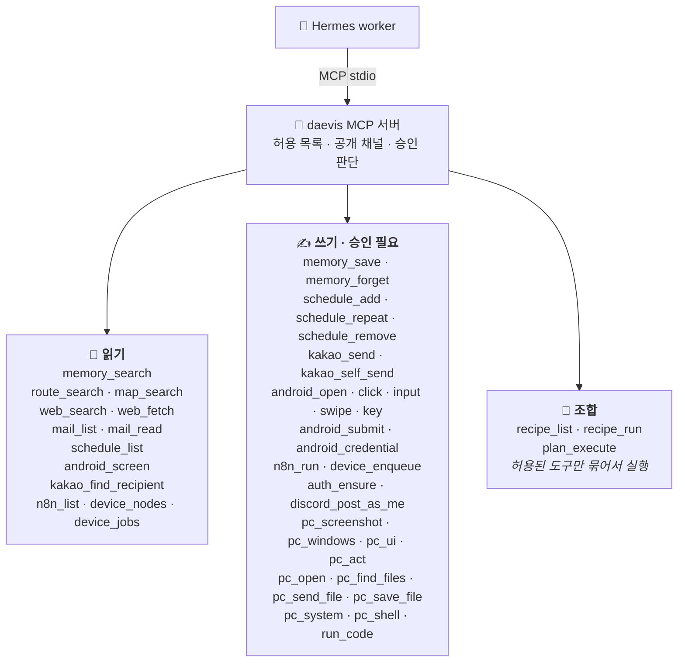

# 대비스 (personal-agent)


Discord로 말을 걸면 서버에서 내 계정으로 일을 끝내는 개인 AI Agent다. 대화와 판단은 [Hermes Agent](https://github.com/NousResearch/hermes-agent)가 맡고, 카톡·네이버·길찾기 같은 한국 서비스 도구는 이 저장소의 MCP 서버가 제공한다. 모델은 ChatGPT 구독 로그인(Codex OAuth)으로 부르기 때문에 API 요금이 따로 나가지 않는다.



## 할 수 있는 일

| | 기능 | 이렇게 말한다 | 처리 방식 | 쓰는 도구 |
| :-: | --- | --- | --- | --- |
|  | 카톡 보내기 | `엄마 카톡 "곧 도착" 보내줘` | 코드가 바로 전송 (모델 0회) | `kakao_send` |
|  | 나와의 채팅에 보내기 | `내 톡방에 이 링크 남겨줘` | 모델 | `kakao_self_send` |
| 🗺️ | 길찾기 | `경로 "강남역" → "판교역"` | 코드가 바로 조회 (모델 0회) | `route_search` |
| 📍 | 장소 검색 | `판교 근처 24시 카페 찾아줘` | 모델 | `map_search` |
|  | 네이버 메일 읽기 | `안 읽은 메일 요약해줘` | 모델 | `mail_list` `mail_read` |
| ⏰ | 알림·반복 예약 | `10분 뒤에 빨래 꺼내라고 알려줘` | 모델, 실행은 예약 루프 | `schedule_*` |
| 🧠 | 기억 | `주차 B2 37번이라고 기억해` | 모델 | `memory_*` |
| 🌐 | 웹 검색·읽기 | `이 링크 세 줄로 요약해줘` | 모델 | `web_search` `web_fetch` |
|  | 앱 화면 조작 | `배민 열어서 최근 주문 보여줘` | 모델이 화면을 보고 한 단계씩 | `android_*` |
|  | 정해진 자동화 실행 | `n8n 상태 확인 돌려줘` | 모델은 이름만 고름 | `n8n_list` `n8n_run` |
| 💻 | 내 PC·폰에 작업 보내기 | `집 PC 켜줘` | 등록한 기기가 가져가 실행 (PC 켜기, 폰 알람, 문자) | `device_*` |
| 🖱️ | 내 PC 원격 조작 | `내 데스크톱에서 발표자료 찾아서 보내줘` | 모델이 PC의 Daevis 에이전트에 한 단계씩 보냄. 파일 검색, 화면 캡처, UI Automation 클릭·입력, PowerShell. 10MB 넘는 파일은 24시간 링크. PC에서 Ctrl+Alt+F12로 끔 | `pc_*` |
| 🧪 | 코드 실행 | `이 CSV 그래프로 그려줘` | 서버의 일회용 Docker 컨테이너(비루트, 512MB, 최대 300초, 인터넷 가능). `/work/out` 파일을 보내 줌 | `run_code` |
| ⚡ | 서버 켜기·끄기 | `대비스 온라인` / `대비스 오프라인` | 상시 서버의 전원 봇 | EC2 API |
| 📱 | Galaxy 앱에서 묻기 | 앱에 적거나 마이크를 누르고 말하기, 디지털 어시스턴트 제스처·빠른 설정 타일로 바로 부르기 | PC 앱과 같은 화면, 같은 대화 기록. 폰의 한국어 TTS로 답을 읽고, 앱을 안 보고 있으면 알림 | `android/` |
| 🖥️ | PC 앱에서 묻기 | 앱 입력창에 적거나 `대비스, 오늘 일정 알려줘`라고 말하기 | 상시 중계가 받아 본체에 전달하고, 진행 단계·답·기록·결제 승인을 앱에 표시 | `desktop/` |

카톡 전송과 길찾기처럼 문장 형태가 정해진 요청은 모델을 부르지 않는다. 오프라인 측정에서 이 방식과 도구 묶음 고르기를 합쳐 요청 20개 기준 모델 입력 토큰이 80% 줄었다.

## 전체 구성

Agent 서버는 쓸 때만 켠다. 꺼진 서버를 켜는 일은 항상 켜 둔 작은 서버의 전원 봇이 맡고, 아무 요청이 없으면 Agent 서버가 스스로 꺼진다.



| 구성 요소 | 파일 | 하는 일 |
| --- | --- | --- |
| Discord 게이트웨이 | `agent/hermes_gateway.py` `agent/gateway.py` | 소유자 확인, 코드 경로 분기, 답장과 결과 표시, 예약 실행, 60초 상태 점검 |
| Hermes worker | `agent/hermes_runner.py` `deploy/hermes-worker.py` | 요청마다 격리된 프로세스로 Hermes를 띄워 모델과 도구를 반복 호출 |
| 반복 제한 | `deploy/hermes_policy.py` | 입력 토큰 6만 초과, 같은 오류 3회 반복, 소유자 거절 시 즉시 멈춤 |
| MCP 서버 | `agent/mcp_server.py` `deploy/run-mcp.sh` | 도구 목록 공개 범위와 승인 판단, 실제 도구 실행 |
| 전원 봇 | `agent/power_bot.py` `agent/power.py` | 정확한 전원 문구만 받아 EC2를 켜고 끔 |
| PC·폰 요청 중계 | `agent/pc_control.py` `agent/voice_relay.py` `agent/voice_agent.py` | 등록한 PC와 폰의 글·음성 요청을 받아 본체에 넘기고, 진행 단계·결제 답·30일 대화 기록(검색, 이어 묻기)을 기기들과 주고받음 |
| Galaxy 앱 | `android/` | 데스크톱과 같은 화면을 WebView로 띄우는 Java 앱. `android/build.py`가 SDK 도구만으로 APK를 만들고, Android build 워크플로가 빌드와 에뮬레이터 실행 확인을 함 |
| 데스크톱 앱 | `desktop/` | WebView2 화면(진행 단계 타임라인), 답변 목소리 선택. 호출어 듣기와 PC 전원 수신은 창 없이 도는 `Daevis.exe --agent`가 맡고 Windows 로그인 때 시작하며, 음성 인식이 멈추면 다시 시작한다. 다른 에이전트용 `Daevis.exe ask --json` 명령줄과 `Daevis.exe mcp` stdio MCP 서버(`ask`·`request_status`·`history`). `desktop-v*` 태그를 올리면 GitHub Actions가 `Daevis.exe`를 Release에 올림 |
| 로그인 | `agent/authgate.py` `agent/login_portal.py` | 저장된 브라우저 세션을 먼저 확인하고, 세션이 없을 때만 로그인을 시도. 실패하면 멈춘 상태를 기록해 반복하지 않음 |
| Android | `agent/android_control.py` `agent/kakao_watch.py` | 화면 트리 읽기, 확인 후 한 번만 누르기, 카톡 전송 검증 |

## 요청 하나가 처리되는 순서

메시지가 들어오면 코드가 먼저 걸러서 모델이 필요 없는 요청을 끝낸다. 남은 요청만 Hermes가 모델과 도구를 오가며 처리한다.



카톡 전송은 결과가 애매하면 다시 보내지 않는다. 같은 메시지가 두 번 가는 것보다 "확인하지 못했습니다"라고 답하는 쪽이 낫다고 봤다.

## MCP 도구

도구는 daevis MCP 서버 하나에 모두 들어 있고, 모델에 무엇을 보여 줄지는 세 단계로 정한다. 기본값은 읽기 도구 4개만 보이는 상태다. 쓰기 도구는 허용 목록에 이름을 넣고 승인 방식을 `discord`로 바꿔야 열리며, 그때도 실행 직전에 소유자 DM 승인을 거친다.



| 단계 | 설정 | 효과 |
| --- | --- | --- |
| 허용 목록 | `DAEVIS_MCP_ALLOW_TOOLS` | 이름이 없는 도구는 모델에게 아예 보이지 않음. 기본값 `memory_search,route_search,map_search,android_screen` |
| 공개 채널 | `DAEVIS_MCP_PUBLIC=1` | 서버 채널 요청이면 기억, 메일, 예약 목록 같은 개인 도구를 숨김 |
| 예약 실행 | `DAEVIS_MCP_READ_ONLY=1` | 소유자가 직접 보낸 요청이 아니면 읽기 도구만 남김 |
| 승인 | `DAEVIS_MCP_APPROVAL=deny` 또는 `discord` | `deny`면 쓰기 도구는 항상 거절. `discord`면 소유자 DM 승인 후 실행 |

Android 화면 이동(열기, 누르기, 입력, 넘기기)은 소유자가 지금 보낸 요청 안에서는 승인 없이 진행한다. 결제, 주문, 동의, 삭제, 로그아웃처럼 되돌리기 어려운 버튼은 화면을 다시 확인한 뒤 따로 승인을 받는다.

## 실행

Python 3.12, Ubuntu 서버 기준이다.

```bash
python3 -m venv .venv
.venv/bin/pip install -r requirements.txt
.venv/bin/python -m agent.login
```

`.env`에 `DISCORD_BOT_TOKEN`, `OWNER_ID`, `HERMES_PYTHON`을 넣고 `deploy/personal-agent-hermes.service`로 실행한다. Hermes 쪽 MCP 설정 예시는 `deploy/mcp-hermes.example.yaml`에 있다. 전원 봇은 별도 상시 서버에서 `python -m agent.power_bot`으로 돌리고, 토큰과 소유자 ID는 AWS Parameter Store에서 읽는다.

테스트:

```bash
python -m pytest tests -q
```

## 보안

- 토큰, 로그인 세션, 기억, 대화 기록은 `data/`와 `.env`에만 두며 Git에 올리지 않는다.
- 소유자 한 명의 메시지만 처리한다. 다른 사람이 같은 서버에서 봇을 불러도 반응하지 않는다.
- 로그인은 저장된 세션을 먼저 쓴다. 계정 정보는 서버 `.env`에만 있고, 휴대폰 본인 인증과 계정 보호조치 해제는 사람이 직접 한다.
- MCP 서버는 stdio로만 연결되고 외부 포트를 열지 않는다. 브라우저 디버깅 포트와 n8n은 `127.0.0.1`에만 묶여 있다.
- 웹 도구는 사설 주소와 클라우드 메타데이터 주소에 접속하지 않는다.
