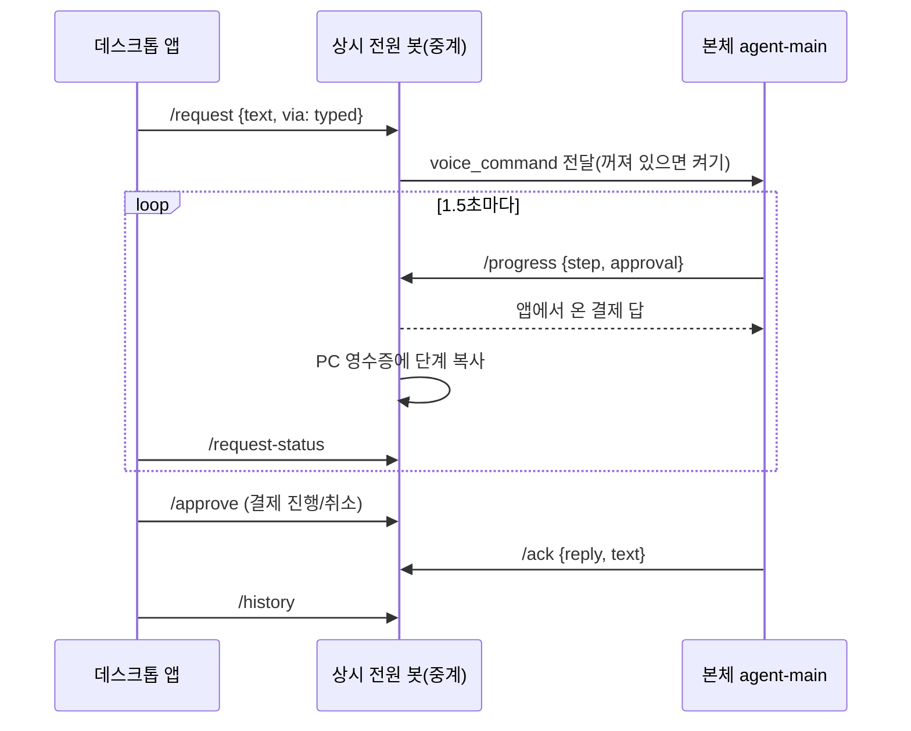

# Discord 말고 PC 앱에서도 대비스에게 묻고 답을 보고 듣는다

> 2026-11-11 · 60b3752, e8628fc 외 · 글로 보낸 요청이 앱 창에서 진행 단계와 답(12.7초, 1회)까지 표시됐다. 기록·결제 응답·답변 목소리 선택을 같은 중계 서버 위에 붙였다.

## 무엇이 문제였나

대비스의 입구는 Discord 하나였다. 11월 10일에 PC 음성 비서(`deploy/voice-pc.py`)를 붙였지만, 이 스크립트는 화면이 없다. 말한 요청의 짧은 답만 소리로 들려주고, 긴 답이나 진행 단계, 지난 요청은 Discord DM을 열어야 볼 수 있었다. 결제 직전 승인도 Discord 버튼으로만 할 수 있었다. 소유자는 Discord 옆에 전용 프로그램을 두고 싶어 했고, 첫 단계로 Windows 데스크톱을 골랐다.

## 왜 그런 일이 생겼나

음성 요청이 지나는 길에 화면용 정보가 없었다.

- PC는 상시 전원 봇의 `voice` 노드로 `/request`를 보내고 `/request-status`로 결과를 읽는다. 결과에는 `say`(서버 켜는 중)와 `reply`(소리용 300자 요약)만 있었다.
- 본체(`agent-main`)는 요청을 처리하면서 진행 단계를 `progress.jsonl`에 쓰지만, 이것은 Discord 메시지를 고칠 때만 읽혔다. 중계 서버로 보내는 길이 없었다.
- 결제 승인은 MCP worker가 요청 폴더에 질문 파일을 쓰고 게이트웨이가 Discord 버튼을 띄우는 방식이라, PC가 답을 넣을 통로가 없었다.
- 요청 기록은 `jobs` 표에만 남았다. 이 표는 1,000줄이 차면 새 요청을 모두 거절하도록(재전송 방지) 만들어져 있어, 앱처럼 요청이 잦은 입구가 생기면 머지않아 전원 봇 전체가 멈출 구조였다.

## 고를 수 있던 방법

| 방법 | 장점 | 버린 이유 또는 고른 이유 |
| --- | --- | --- |
| 앱이 본체 서버에 직접 연결 | 단계·결제를 바로 주고받음 | 본체는 평소 꺼져 있고 IP가 바뀐다. 켜는 일은 상시 전원 봇만 할 수 있어 버림 |
| 기존 중계 위에 엔드포인트 세 개 추가 | PC 등록 토큰·HTTPS 경로·서버 켜기를 그대로 씀 | 고름. `/history`, `/approve`(PC), `/progress`(본체) |
| 결제 답을 본체가 따로 폴링 | 구조가 단순해 보임 | 본체 요청이 하나 더 생김. 이미 1.5초마다 보내는 `/progress`의 응답에 답을 실어 보내기로 함 |
| 화면을 Tkinter로 | 추가 의존성 없음 | 처음 만들어 봤지만 소유자가 "아이언맨 비서 같은" 화면을 원했고 Tk로는 발광·애니메이션 표현이 어려워 버림 |
| 화면을 WebView2(pywebview)로 | Windows 11에 런타임이 있고 HTML/CSS/캔버스로 HUD 표현 | 고름. pywebview 6.2.1(BSD), pythonnet 3.0.5(MIT) |

### 답변 목소리 조사

이 PC에서 직접 확인한 것과 문서에서 확인한 것을 나눠 적는다.

| 후보 | 확인한 사실 | 결정 |
| --- | --- | --- |
| Windows 음성(System.Speech) | 이 PC에 설치된 한국어 음성은 `Microsoft Heami Desktop` 하나(SAPI 열거). OneCore 쪽도 `koKR_HeamiM` 하나 | 오프라인 기본값으로 유지 |
| Edge TTS (`edge-tts` 7.3.1) | PyPI 라이선스 LGPLv3. Edge "소리 내어 읽기"의 온라인 서비스를 부르는 비공식 방법. 한국어 음성 3개(SunHi 여성, InJoon 남성, HyunsuMultilingual 남성)가 목록에 나옴. 짧은 문장 합성 1.57초(프로세스 시작 포함, 1회) | 채택. 실패하면 해미로 자동 대체 |
| MeloTTS | MIT, 한국어 지원(저장소 README). "CPU 실시간"이라고 적혀 있지만 근거 수치는 없음. torch·MeCab 계열 의존성 | 첫 단계에서 제외. 설치 부담이 크고 직접 들어 보지 않음 |
| Supertonic 2/3 | 가중치는 OpenRAIL-M(용도 제한 조항), 코드 MIT. 한국어 지원은 Hugging Face 모델 카드 기준(2차 확인) | 제외. 라이선스 조항 검토와 음질 청취가 먼저 |

## 바꾼 것

- 중계(`agent/pc_control.py`): `voice_history` 표(30일 보관)와 `approval_answers` 표 추가. `history()`는 등록된 PC만, 최신순 페이지. `agent_progress()`는 본체가 자기 요청에만 단계를 쓰고 쌓인 결제 답을 받아 감. `approve()`는 요청을 보낸 PC만 답할 수 있음. 끝난 음성 작업은 하루 뒤 `jobs` 표에서 지워 1,000줄 한도에 닿지 않게 함. 대기 중인 PC 종료 작업은 지우지 않음.
- 요청 형식(`agent/device_nodes.py`): `voice_command`에 선택 항목 `via`(`voice`/`typed`), 글 요청 500자까지.
- 중계 흐름(`agent/voice_relay.py`): 본체 단계를 PC 영수증에 바뀔 때만 복사. 글 요청은 DM에 ⌨️로 남김. 본체가 다른 요청을 처리하느라 폴링을 쉬는 동안 "서버를 켜고 있어요"라고 잘못 말하던 것을, 실제로 켠 경우에만 말하도록 고침.
- 본체(`agent/voice_agent.py`): 요청을 처리하는 동안 `current_state()`로 단계와 결제 질문을 보고, 받은 답은 `approvals.answer()`로 같은 파일 통로에 씀. Discord 버튼과 앱 중 먼저 누른 쪽이 적용된다. 결과에 전체 답(`text`)을 2,048자 안에서 함께 보냄.
- 앱(`desktop/`): `relay.py`(요청·추적·기록·결제·등록), `core.py`(요청 흐름, 호출어 듣기, PC 종료 수신기, 예전 음성 스크립트 정리, 자동 실행), `tts.py`(목소리), `bridge.py`(화면이 부를 수 있는 함수만 공개), `ui/index.html`(HUD), `build.py`(PyInstaller 한 파일 exe).
- 호출어 "대비스"는 `deploy/voice-pc.py`를 고치지 않고 그대로 불러 쓴다. 앱이 듣기 시작하면 같은 말을 두 번 처리하지 않도록 예전 `DaevisVoice` 자동 실행과 프로세스를 끈다.
- 새 PC 등록: 앱 첫 화면에 Discord "PC 등록" 명령을 통째로 붙여 넣으면 코드만 골라 `/enroll`하고, 설치 스크립트와 같은 `~/.daevis/pcs/<node>/` 파일을 만든다. Python 수신기가 없는 PC에서는 앱이 PC 종료 수신기(`deploy/device-node.py`)를 함께 돌린다.
- 배포: `.github/workflows/desktop-release.yml`이 `desktop-v*` 태그에서 테스트 후 `Daevis.exe`를 만들어 Release에 올린다.

### 다른 에이전트가 쓰는 입구: 명령줄과 MCP

소유자가 "agentic friendly하게, CLI와 MCP로도 요청할 수 있게"를 요청했다. 화면과 같은 요청 흐름(`core.Controller`)을 세 군데에서 쓴다.

- 진행 단계 타임라인: 본체가 지금 단계뿐 아니라 지금까지 거친 단계 목록(`steps`, 최대 8개)을 함께 보낸다. 화면은 끝난 단계와 진행 중 단계를 세로 줄로 보여 준다.
- 명령줄(`desktop/cli.py`): `Daevis.exe ask "…" --json`은 started → step → answer를 한 줄씩 JSON으로 내보내고, 답을 받으면 종료 코드 0, 아니면 1이다. `history --json`도 있다. 파이프로 받으면 UTF-8, 콘솔에서 치면 콘솔 코드 페이지로 쓴다.
- MCP 서버(`desktop/mcp_server.py`, `Daevis.exe mcp`): stdio. 도구는 `ask`(기다리거나 id만 받기), `request_status`, `history`. 결제 질문은 보여 주기만 하고 답은 못 한다. 결제 승인은 사람(소유자)이 앱이나 Discord에서만 한다.

가짜 이벤트를 넣어 그린 단계 타임라인과 결제 확인 패널(실제 주문 아님):

## 확인한 것

- 전체 테스트 865개 통과(`tests/private` 제외). 새 테스트: `tests/test_desktop_relay.py`(실제 HTTP 핸들러 포함), `tests/test_desktop_app.py`, `tests/test_desktop_bridge.py`, `tests/test_desktop_mcp.py`.
- 전원 봇에 세 파일 배포 후 재시작, 이 PC의 실제 등록 정보로 `/history` 200, 남의 요청에 `/approve` 401 확인.
- 글 요청 끝까지(실제 서버, 각 1회): Tk 시험판에서 "지금 몇 시…"가 40.5초(본체가 다른 요청 처리 중), HUD 창에서 "3 곱하기 7…"이 답 `21`(답 꼬리표 기준 처리 12.7초). 왼쪽 기록에 요청·상태가 나타나고 다시 열면 답이 보였다.
- 명령줄(실제 서버, 1회씩): 소스로 "브라우저로 오늘 서울 날씨…"를 보내 단계가 `웹 검색하는 중` → `웹 페이지 읽는 중` 순서로 흘러나오고 답(처리 37.0초)과 종료 코드 0을 받았다. 로컬 빌드 exe를 파이프로 실행해 답 `13`, 종료 코드 0.
- MCP(실제 서버, `mcp` 1.30.0 stdio 클라이언트로 1회씩): 소스 서버에서 도구 3개 목록, `history`, `ask` 16.6초. 로컬 빌드 exe(`Daevis.exe mcp`)에서도 같은 순서로 `ask` 14.6초.
- 로컬 빌드 exe(약 129MB)를 이 PC에서 실행해 HUD, 기록, 음성 인식 모델 로드(로그에 "대비스라고 부르면 들어요")를 확인했다.
- 설정 패널에서 목소리 4종, 들어보기 버튼, 속도, 토글이 그려지는 것을 화면으로 확인. Edge 목소리 합성과 재생은 스크립트로 1회 확인.

## 틀린 지점

- 화면에 진행 단계가 늦게 나오거나 안 나왔다. 원인은 두 개였다. 마이크 소리 크기 이벤트가 초당 10개씩 같은 큐로 화면에 가면서 단계 이벤트가 뒤로 밀렸고, 단계 표시 조건이 답 칸 대신 내 질문 글자 칸을 찾아 "이미 답이 있다"고 판단했다. 이벤트를 묶어 보내며 소리 크기는 최신 값 하나만 남기고, 조건을 답 칸으로 좁혔다.
- 앱이 화면보다 먼저 보낸 상태("모델 불러오는 중"→"듣고 있어요")가 사라져 화면이 계속 불러오는 중이라고 보였다. 화면이 준비될 때까지 이벤트를 붙잡고, 마지막 상태를 부팅 때 넘기도록 고쳤다.
- exe를 명령줄로 실행하면 첫 시험에서 "요청을 찾지 못했어요"로 끝났다. 창 모드 exe의 출력 처리 중 예외가 요청 추적을 끊었다. 출력 오류는 요청을 끝내지 않게 하고, 파이프와 콘솔을 나눠 처리했다.
- 이 세션의 셸은 Claude 앱 컨테이너 안에서 돈다. 처음에 exe를 `%LOCALAPPDATA%`에 복사했더니 실제로는 앱 전용 가상 폴더에 들어갔다. 설치 위치를 가상화되지 않는 `~/.daevis/app`으로 바꿨다. 같은 이유로 이 세션에서 쓴 로그인 자동 실행 레지스트리 값이 실제 Windows에 반영됐는지는 확인할 수 없다.

- 첫 끝-대-끝 시험이 6초 만에 "요청을 찾지 못했어요"로 끝났다. 원인은 시험 스크립트의 콘솔 출력 인코딩 오류였지만, 추적 중 예외 하나가 요청 전체를 실패로 만든다는 약점이 드러났다. 연속 10번 실패할 때까지는 재시도하도록 고치고 테스트를 붙였다.
- 처음 만든 Tkinter 화면은 기능은 됐지만 소유자가 원한 분위기와 거리가 멀어 WebView2 HUD로 다시 만들었다.

## 아직 모르는 것

- 마이크로 "대비스"를 불러 앱이 답하는 과정은 소유자가 직접 시험하기로 했다. 음성 요청은 글 요청과 같은 중계 경로를 쓰고 `via`만 다르지만, 앱 안의 듣기 스레드는 실제 음성으로 확인하지 않았다.
- 결제 승인은 테스트(실제 HTTP 핸들러와 파일 통로)로만 확인했다. 실제 결제 화면에서 앱 버튼으로 승인한 적은 없다. 앱에서 답한 뒤에도 Discord 메시지의 버튼은 남는다(눌러도 이미 끝난 질문이라 아무 일도 하지 않는다).
- GitHub Release는 아직 없다. 태그를 올리면 공개 릴리스가 생기므로 이 세션의 권한 정책이 막았고, 소유자 확인을 기다린다. 워크플로 자체는 GitHub에서 한 번도 돌지 않았다.
- 로그인 자동 실행: 소유자가 `~/.daevis/app/Daevis.exe`를 직접 한 번 실행해야 실제 Windows에 등록된다(위 컨테이너 문제).
- Release exe를 다른 PC에 설치해 등록하는 흐름은 아직 해 보지 않았다.
- `edge-tts`는 비공식 경로라 Microsoft가 막으면 해미로만 답하게 된다.

## 셀프 인터뷰

**왜 앱이 본체 서버에 직접 붙지 않고 중계를 거치나요?**
본체는 쓸 때만 켜는 서버라 평소에는 꺼져 있고 주소도 바뀝니다. 항상 켜져 있는 전원 봇이 이미 PC 등록 토큰, HTTPS 경로, 서버 켜기를 갖고 있어서 그 위에 엔드포인트 세 개만 더했습니다.

**결제 답을 왜 진행 보고의 응답에 실어 보냈나요?**
본체는 요청을 처리하는 동안 1.5초마다 진행 단계를 중계에 올립니다. 그 응답에 답을 실으면 본체가 새로 폴링할 필요가 없고, 기존 결제 파일 통로(`approvals.answer`)를 그대로 쓰므로 Discord 버튼과 앱 중 먼저 누른 쪽이 자연스럽게 이깁니다.

**MCP에서 결제를 승인하지 못하게 한 이유는요?**
MCP로 붙는 쪽은 다른 에이전트입니다. 결제는 돈이 나가는 되돌릴 수 없는 일이라, 에이전트가 스스로 승인하면 사람 확인이라는 원래 목적이 사라집니다. 그래서 질문은 보여 주되 답은 앱 창이나 Discord에서 소유자만 하게 했습니다.

**기록을 왜 `jobs` 표와 따로 두었나요?**
`jobs`는 재전송을 막으려고 1,000줄이 차면 새 요청을 모두 거절합니다. 앱으로 요청이 잦아지면 전원 봇 전체가 멈출 수 있어, 끝난 음성 작업은 하루 뒤 지우고 사람이 볼 기록은 30일짜리 별도 표에 남겼습니다.

## 산출물

- 커밋: `60b3752` 앱과 중계, `e8628fc` 상태·포커스 수정, 이후 커밋에 단계 타임라인·명령줄·MCP
- 테스트: `tests/test_desktop_relay.py`, `tests/test_desktop_app.py`, `tests/test_desktop_bridge.py`, `tests/test_desktop_mcp.py`, `tests/test_voice.py`(형식 변경 반영)
- 자료: `docs/worklogs/assets/2026-11-11-desktop-app/`
