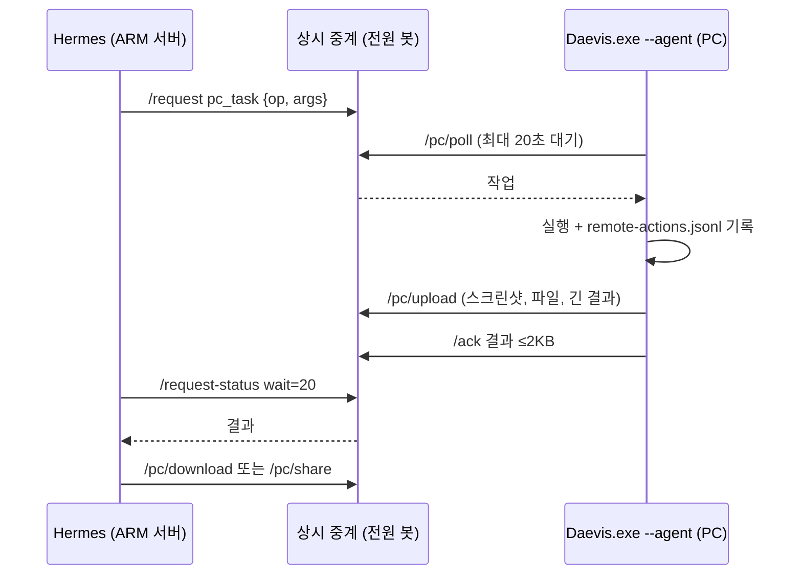

# 서버의 대비스가 내 Windows PC를 조작하고, 서버에 코드 실행 칸을 만들었다

> 2026-11-12 · 커밋은 아래 산출물 참고 · "내 데스크톱에서 발표자료 찾아서 보내줘"가 실제 요청 경로로 35~49초에 끝났다(3회 실행, 2회 전송 성공)

## 무엇이 문제였나

대비스 본체는 AWS의 ARM 서버에서 돈다. 소유자의 Windows PC에는 `Daevis.exe --agent`가 상시 중계(전원 봇)에 붙어 있었지만, 이 연결로 할 수 있는 일은 음성 요청 전달, 전원 끄기, 문자 표시뿐이었다. "PC에 있는 파일 보내줘", "지금 화면 보여줘", "이 창에서 저장 눌러줘" 같은 요청은 서버가 PC를 볼 방법이 없어서 처리할 수 없었다. 서버 쪽에서도 모델이 계산이나 그래프 그리기 코드를 돌릴 격리된 곳이 없었다.

소유자는 전체 PC 조작(PowerShell 포함)과 인터넷이 되는 서버 샌드박스를 허락했다. 결제만 승인을 받는다는 기존 정책은 그대로이고, PC 동작은 소유자가 직접 보낸 요청 안에서만 실행된다(기존 owner lease).

## 왜 그런 일이 생겼나

구조상 이유가 세 가지였다.

1. **결과 크기.** 중계의 작업 영수증(`jobs.result`)은 JSON 2KB까지다. 스크린샷이나 파일은 실을 수 없다.
2. **전달 속도.** PC 수신기는 5초마다 폴링했다. 클릭 한 번에 평균 2.5초가 더해지면 여러 단계짜리 조작은 쓸 수 없다.
3. **같은 노드를 두 수신기가 공유.** 기존 전원 수신기(`deploy/device-node.py`)는 `/poll`에서 가장 오래된 작업을 가져간다. 새 작업 종류를 같은 노드에 넣으면 전원 수신기가 가로챈다.

## 고를 수 있던 방법

| 방법 | 장점 | 버린 이유 또는 고른 이유 |
| --- | --- | --- |
| PC에 포트를 열고 서버가 직접 접속 | 가장 빠르다 | 가정 공유기 포트 개방과 인증서 관리가 필요해서 버림 |
| 기존 중계에 작업 종류 `pc_task`를 추가하고 long-poll | 새 포트 없음, 인증·소유자 등록을 그대로 씀 | **고름** |
| 파일을 영수증에 base64로 | 엔드포인트 추가 없음 | 2KB 제한을 넘어서 버림 |
| 중계에 첨부 업로드/다운로드 엔드포인트 | 크기 제한이 영수증과 분리됨 | **고름** (파일당 100MB, 1시간 보관) |
| 파일 검색을 매번 디스크 순회 | 항상 최신 | 이 PC에서 5분 넘게 걸려서 버림(아래 측정) |
| Windows Search 색인만 사용 | 빠르다 | 사용자 폴더만 색인되고 D: 드라이브가 빠져 있어서 단독으로는 버림 |
| PC 에이전트가 백그라운드로 파일 이름 색인 | 검색 0.3초 | **고름**, Windows Search와 사용자 폴더 실시간 순회를 함께 씀 |
| 큰 파일을 압축해 Discord로 | 링크 없이 첨부 | pptx는 이미 압축 형식이라 10MB 아래로 안 내려가서 버림 |
| 큰 파일은 24시간 다운로드 링크 | 크기와 무관 | **고름** |

## 바꾼 것

**중계** (`agent/pc_remote.py`, `agent/pc_control.py`, `agent/device_nodes.py`)
- `pc_task` 작업 종류와 허용 op 목록(`PC_OPS`), payload 3000자 제한.
- `/poll`은 `pc_task`를 내주지 않고, `/pc/poll`은 `pc_task`만 내준다. 같은 노드에서 두 수신기가 일을 나눈다.
- 시작할 때 `ensure_pc_tasks()`가 등록된 PC에 `pc_task` 능력을 붙이고 `agent-main`에 권한을 준다. 새로 등록하는 PC도 같다.
- 첨부: `/pc/upload`(본문을 파일로 흘려 쓰고, 업로드한 쪽과 받을 쪽을 정해 둠), `/pc/download`, `/pc/share`(24시간 링크), `GET /share/<token>`. 링크 토큰은 해시만 저장한다.
- 결과에 화면 글자나 파일 목록이 들어가므로, 발행자가 최종 영수증을 읽으면 결과를 지우고 끝난 `pc_task`는 1시간 뒤 지운다. 중계의 작업 기록 1000개 한도가 차서 모든 요청이 막히는 일도 이걸로 막는다.

**PC** (`desktop/remote.py`, `desktop/pc_ops.py`, `desktop/uia.py`, `desktop/file_index.py`)
- 스크린샷(모든 모니터, 1600px JPEG), 창 목록, UI Automation 트리(comtypes, e1·e2 번호), 클릭·입력·단축키·스크롤(SendInput, 한글은 유니코드 입력), 열기, 파일 검색, 파일 보내기·받기(다운로드 폴더에 덮어쓰지 않고 저장), 볼륨·미디어·잠금·절전·종료(60초 유예), PowerShell.
- 끄기: Ctrl+Alt+F12(높은 삐 소리 켜짐, 낮은 소리 꺼짐)와 앱 설정의 "대비스가 이 PC 조작하기". 꺼져 있으면 실행하지 않고 `remote_off`로 답한다. 앱이 다른 설정을 저장할 때 단축키로 바꾼 값을 되돌리지 않도록 저장 전에 다시 읽는다.
- 기록: `~/.daevis/desktop/remote-actions.jsonl`에 시간, op, 인자(200자로 자름), 결과, 걸린 시간.
- 파일 색인은 폴더 경로와 파일 이름만 저장하고 크기·날짜는 검색 결과에 대해서만 디스크에서 읽는다. 12시간마다 다시 만든다.

**서버** (`agent/pc_tools.py`, `agent/sandbox.py`, `agent/gateway.py`, `agent/voice_agent.py`)
- 도구 11개 `pc_*`와 `run_code`. 모두 `PRIVATE_TOOLS`라 공개 채널에서는 보이지 않는다.
- PC 파일은 요청 outbox의 `files/`에 받고, Gateway가 Discord로 첨부한다. Discord가 첨부 이름의 한글을 지워서(`러너스하이_…_v5.html`이 `v5.html`로 보임) 캡션에 원래 이름을 적는다. 10MB를 넘으면 도구가 링크를 돌려주고 모델이 답에 적는다.
- PC 앱 요청이면 보낸 파일마다 링크를 영수증 끝에 붙이고, 앱은 그 줄을 "📎 이름 받기" 버튼으로 보여 준다. 버튼은 중계의 `/share/` 주소만 연다.
- `run_code`: 요청마다 컨테이너 1개, `--user 1000:1000`, `--read-only`, `--cap-drop ALL`, `no-new-privileges`, 메모리 512MB(스왑 포함 768MB), CPU 1개, pids 256, 시간 1~300초, 네트워크 bridge. 마운트는 실행 폴더 `/work` 하나다(`.env`, `data/`, Docker 소켓 없음). 이번 요청의 파일은 마운트하지 않고 `/work/in`으로 복사한다. 동시에 1개만 돈다. 이미지는 `deploy/sandbox/Dockerfile`(python 3.12, pandas·matplotlib·requests·openpyxl·python-pptx, 나눔 글꼴).

## 확인한 것

- 관련 테스트: 중계 35개, PC 34개, 서버 도구 20개, 샌드박스 11개, Gateway·음성·앱 연동 추가분 포함. 전체 공개 테스트 992개 통과. `test_phone_call.py::test_install_script_is_served_and_is_valid_bash`는 Windows 경로를 bash에 넘기는 환경 문제로 이 PC에서 실패해서 제외했다. 이번에 건드리지 않은 파일이다.
- 서버에서 HTTPS로 실제 PC 호출, 각 1회: 창 목록 0.2초, 파일 검색 1.7~2.3초, 스크린샷 0.5초, PowerShell 0.7초, UI 트리 0.5초. 설치한 exe(PyInstaller)로도 같은 호출이 됐다.
- 파일 검색, 이 PC에서 각 1회: 순수 Python 순회는 60초 동안 D:에서 53만 개를 보고도 끝나지 않았다. 스레드 12개로 나누면 40초에 15만 개로 오히려 느렸다(이름 정규화가 CPU를 써서 GIL에 막힘). `dir /s`는 5분 안에 끝나지 않았다. 색인은 582만 개를 47초에 만들었고, 241MB에 검색 0.34초다. 처음에 크기·날짜까지 저장했을 때는 1.1GB였다. 파일의 63%(370만 개)가 게임 에셋 PNG였다.
- 실제 요청 "내 데스크톱에서 발표자료 찾아서 보내줘", PC 앱 CLI → 중계 → 본체 → PC → Discord DM:
  - 1차(48초): 검색은 됐지만 모델이 pptx·pdf만 찾았고, 나온 파일이 58~68MB라 보내지 못하고 되물었다.
  - 2차, 3차(42초, 49초): html 덱까지 찾아 최신 `러너스하이_기능제안_발표_v5.html`을 보냈다. Bot API로 DM을 읽어 첨부 크기가 원본과 같은 7,708,813바이트인 것을 확인했다. 3차는 앱 영수증의 링크로 받은 바이트 수도 같았다.
- 68.6MB pptx: PC에서 중계로 올리는 데 7.3초, 링크로 서버에서 받은 크기 68,618,944바이트(원본과 같음).
- 샌드박스, 서버에서 각 1회: uid 1000, 인터넷 HTTP 200, 토큰 환경 변수 없음, Docker 소켓 없음, 루트 파일 시스템 쓰기 거부, 900MB 할당은 OOM으로 137 종료, 3초 제한은 3.5초에 종료, `pip install`은 `/work/.local`로 됨, 한글 그래프 제목 경고 없음.
- 서버 여유 메모리는 부팅 직후 969MB에서 서비스가 안정된 뒤 1.8GB였다(`free -m`, 각 1회).

## 틀린 지점

- **소유자의 메모장을 덮어썼다.** 입력 시험으로 `pc_open notepad`를 부르자, 새 창 대신 소유자가 저장하지 않은 문서가 열린 기존 메모장이 앞으로 왔다. 창 제목 일부("메모장")로 그 창을 골랐다. 문서 요소에 포커스를 주자 내용이 모두 선택돼서, 입력한 시험 문장이 원래 내용을 덮었다. 그 뒤 PowerShell로 메모장을 강제 종료했다. Windows 11 메모장의 자동 저장 덕분에 다시 열자 탭 5개가 복원됐다. 덮기 직전에 UI 트리로 읽어 둔 원래 내용을 그 탭에 그대로 넣었고, 다시 읽어 같은 것을 확인했다. 그 UI 트리 결과가 중계 영수증에 남아 있어서, 지금까지의 `pc_task` 결과 20건을 지웠다. 읽은 결과를 바로 지우는 동작도 추가했다.
  - 바꾼 것: 도구 설명에 "type은 선택된 내용을, set_value는 전체를 덮어쓴다", "이미 열린 창이 앞으로 올 수 있다"를 넣었다. 시험은 소유자의 앱이 아니라 시험용 파일로 해야 한다.
- 스레드로 파일 순회를 빠르게 하려 했지만 더 느려졌다. 측정해 보고 버렸다.
- Dockerfile의 `printf "\n"`이 셸과 Python 스크립트를 거치며 실제 줄바꿈이 돼 빌드가 두 번 깨졌다. `echo` 두 줄로 바꿨다.

## 아직 모르는 것

- 클릭(`pc_act click`), 단축키, 볼륨·잠금·종료는 실제 PC에서 서버로 불러 보지 않았다. 단위 테스트와 입력 함수만 확인했다. 메모장 사고 뒤에는 소유자가 쓰는 화면에서 추가 시험을 하지 않았다.
- 관리자 권한 창에는 Windows가 입력을 막는다(UIPI). 그런 창에서 어떻게 실패하는지 아직 보지 않았다.
- Ctrl+Alt+F12는 등록 실패 시 로그만 남긴다. 실제로 눌러서 바뀌는지는 보지 않았다(설정 파일 경로는 테스트로 확인).
- Discord 요청 창에서 직접 보낸 경우는 시험하지 않았다. 시험은 PC 앱 CLI 경로로 했고, 답과 파일은 같은 소유자 DM으로 갔다.
- 링크는 아는 사람 누구나 24시간 받을 수 있다. 소유자 DM과 앱에만 나가지만, 전달되면 남도 받는다.

## 셀프 인터뷰

**Q. 왜 PC에 서버를 띄우지 않고 중계를 거쳤나요?**
A. 가정용 회선에 포트를 열면 공유기 설정, 동적 IP, 인증서를 따로 관리해야 합니다. 이미 PC가 바깥으로 연결해 인증하는 중계가 있었으므로 작업 종류 하나와 long-poll만 더했습니다. 한 단계 지연은 서버에서 잰 값으로 0.2~0.7초였습니다.

**Q. 같은 PC 노드를 두 수신기가 같이 폴링하면 작업을 서로 가져가지 않나요?**
A. 가져갈 수 있어서 작업 종류로 나눴습니다. `/poll`은 `pc_task`를 빼고, `/pc/poll`은 `pc_task`만 줍니다. 이전 수신기가 `pc_task`를 받지 않는다는 테스트를 넣었습니다.

**Q. 파일 이름 색인이 241MB인데 과하지 않나요?**
A. 매번 순회하면 5분이 넘어 요청 제한 시간 안에 못 끝납니다. 처음 1.1GB에서 크기와 날짜를 빼고 폴더 경로를 따로 저장해 줄였습니다. 더 줄이려면 에셋 폴더를 건너뛰는 규칙이 필요한데, 소유자가 이미지 파일을 찾을 수도 있어 넣지 않았습니다.

**Q. 메모장 사고에서 무엇을 배웠나요?**
A. 원격 조작 시험은 소유자가 쓰는 앱 위에서 하면 안 됩니다. 창 이름이 같으면 도구가 기존 창을 고를 수 있고, 포커스만으로 전체 선택이 될 수 있습니다. 결과에 화면 글자가 담기므로 중계에 오래 남기지 않게 했습니다.

## 산출물

- 코드와 기록: 이 글과 같은 커밋(해시는 README 목록 커밋 메시지 참고).
